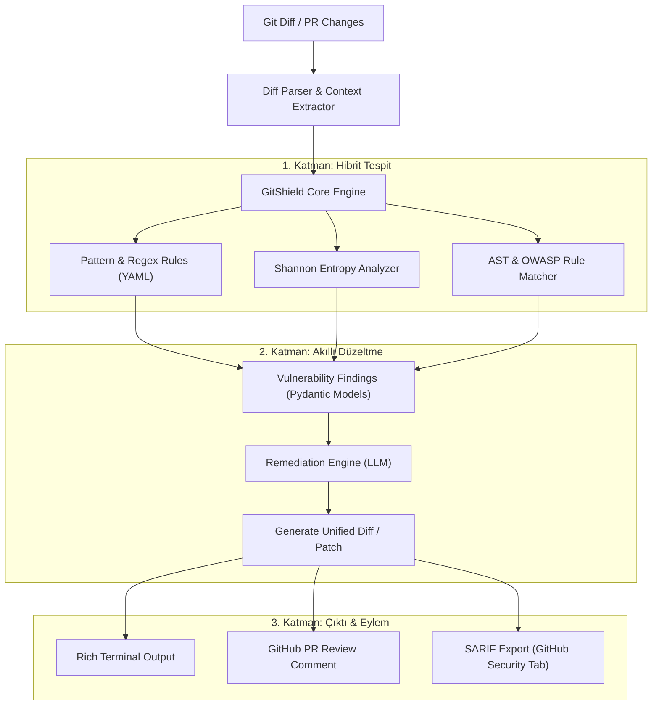

# 🛡️ GitShield

> **AI Destekli Akıllı PR Güvenlik Denetçisi & Otomatik Düzeltme Motoru**  
> *Sadece güvenlik açığını bulmakla kalmaz; doğrudan PR'a uygulanabilir güvenli diff/patch önerir.*

[](https://github.com/AlperEnesErsu/GitShield/actions)
[](https://www.python.org/)
[](LICENSE)
[]()

---

## 🎯 Neden GitShield?

Geleneksel SAST (Statik Kod Analizi) araçları geliştiricilerin önüne yüzlerce satırlık kafa karıştırıcı uyarı yığar ve çoğu zaman geliştiriciler bu uyarıları kapatıp geçer. 

**GitShield'ın Farkı:**
1. **Sıfır Gürültü:** Sadece PR'daki **değişen satırları (git diff)** tarar. Eski kod tabanındaki borçları yüzünüze vurup süreci tıkamaz.
2. **Shannon Entropi + Heuristic Secret Tespiti:** Yalnızca regex değil, yüksek rastgelelik (Shannon Entropy) analizi ile API anahtarlarını, özel anahtarları ve token'ları %99 doğrulukla yakalar.
3. **OWASP Top 10 + Supply Chain Koruması:** SQL Injection, XSS, Path Traversal, güvensiz deserialization ve şüpheli paket bağımlılıklarını hedefler.
4. **💡 AI-Powered Auto-Remediation:** Tespit edilen zafiyeti düzeltecek temiz, güvenli ve test edilmiş **git diff / patch** çıktısını anında üretir. Geliştirici tek tıkla yamayı uygulayabilir.
5. **İki Modda Çalışma:** Hem yerel terminalde (`gitshield scan`) hem de GitHub Action olarak CI pipeline'ında PR yorumcusu olarak çalışır.

---

## 🏗️ Sistem Mimarisi



---

## ⚡ Hızlı Başlangıç

### 1. Kurulum (uv veya pip ile)

```bash
# Depoyu klonlayın
git clone https://github.com/AlperEnesErsu/GitShield.git
cd GitShield

# uv ile ortamı ve bağımlılıkları hazırlayın
uv venv
source .venv/bin/activate  # Windows: .venv\Scripts\activate
uv pip install -e ".[dev]"
```

### 2. Ortam Değişkenleri

```bash
cp .env.example .env
# .env dosyasında LLM API anahtarınızı (Gemini, Claude veya OpenAI) tanımlayın:
# GEMINI_API_KEY="AIzaSy..."
```

### 3. Kullanım

```bash
# Mevcut çalışma alanındaki son commit/staged değişiklikleri tara
gitshield scan

# Belirli bir commit veya branch diff'ini incele
gitshield scan --branch main..HEAD

# Güvenlik açığı bulduğunda otomatik AI düzeltme diff'i üret
gitshield scan --fix

# Çıktıyı SARIF formatında kaydet
gitshield scan --format sarif --output results.sarif
```

---

## 🖥️ Web Dashboard (PR Review Merkezi)

Erişim yetkin olan tüm GitHub repolarını tablolaştırır, açık PR'ları AI ile inceler, üretilen
review'u ikinci bir LLM geçişiyle doğrular ve **senin onayınla** PR'a gönderir.

- **Repolar tablosu:** açık PR / issue sayıları, açılmamış taslak issue'lar, son push, yetki; sıralama ve filtre.
- **Repo sayfası:** PR tablosu + katlanır iki bölüm: GitHub issue'ları ve bulgulardan üretilen
  *henüz açılmamış taslak issue'lar* (düzenle → "GitHub'da aç" ya da yoksay).
- **PR sayfası:** GitShield taraması → AI review → doğrulayıcı (doğrulandı / belirsiz / reddedildi).
  Yorumları seç, düzenle, diff üzerinde satır içinde gör, onaylayıp GitHub'a gönder.

**İş akışını hızlandıran özellikler (GitHub'da yok):**

| Özellik | Ne yapar |
|---|---|
| **Bekleyenler** (`/inbox`) | Tüm repolardaki onay bekleyen review'lar, yeni commit'ler, incelenmemiş PR'lar ve taslak issue'lar tek listede, aciliyet ve risk sırasıyla. |
| **Otomatik inceleme** | Repo sayfasındaki anahtarla açılır; yeni PR ya da commit gelince arka planda incelenir, sonuç onayını bekler. |
| **Hızlı mod** (`/triage`) | Klavyeyle onay: `j/k` yorumlar, `x` çıkar, `m` bir daha söyleme, `a/r/c` karar, `Enter` gönder, `n` atla. |
| **Risk skoru** | Her PR için 0-100 açıklamalı skor: boyut, hassas dosyalar, CI, yeni katkıcı, testsiz kod, major sürüm. |
| **Bağımlılık toplu onayı** | CI'ı yeşil minor/patch Dependabot PR'ları taranıp tek tıkla onaylanır; kurallar sunucuda da uygulanır. |
| **Artımlı inceleme** | Yeni commit'lerde yalnızca fark incelenir; önceki yorumların düzeltilip düzeltilmediği takip edilir. |
| **Repo hafızası** | Susturulan yorumlar tekrarlanmaz; repoya özel kurallar her review'a verilir. |
| **Düzeltme PR'ı** | Bir yorumdan önizlemeli, düzenlenebilir küçük bir düzeltme PR'ı açılır. |
| **Bildirimler** | Masaüstü bildirimi ve Slack / Discord / Telegram. |
| **Metrikler** (`/metrics`) | Merge süresi, açık PR yaşı, SLA'yı aşanlar ve GitShield'ın kendi gecikmeleri. |

```bash
uv pip install -e ".[web]"
cd web && npm install && npm run build && cd ..
gitshield web            # http://127.0.0.1:8000
```

Geliştirme için `gitshield web --reload` ve ayrı bir terminalde `cd web && npm run dev`
(http://localhost:5173, `/api` istekleri 8000'e proxy'lenir).

LLM sağlayıcısı `.env` üzerinden seçilir (`LLM_PROVIDER=anthropic|gemini|openai|none`, `LLM_MODEL`).
GitHub token'ı `.env` içinde yoksa `gh auth token` kullanılır. Sunucu GitHub token'ını kullandığı için
yalnızca `127.0.0.1`'e bağlanır; ağa açmadan önce bir kimlik doğrulama katmanı ekleyin.

---

## 📁 Proje Yapısı

```
GitShield/
├── gitshield/
│   ├── cli.py             # Typer tabanlı terminal arayüzü
│   ├── config.py          # Yapılandırma ve kural yöneticisi
│   ├── core/              # Diff ayrıştırıcı, entropi motoru, veri modelleri
│   ├── rules/             # YAML tabanlı tespit kuralları (secrets, owasp)
│   ├── ai/                # LLM prompt şablonları ve otomatik yama üreticisi
│   ├── formatters/        # Terminal (Rich), Markdown ve SARIF çıktı motorları
│   └── web/               # FastAPI: GitHub API, review hattı, doğrulayıcı, SQLite
├── web/                   # React + Vite dashboard
├── tests/                 # Kapsamlı birim ve entegrasyon testleri
├── .github/workflows/     # CI/CD & GitHub Action şablonları
├── ARCHITECTURE.md        # Detaylı mimari ve tasarım kararları
└── pyproject.toml         # Modern Python paket tanımı (uv uyumlu)
```

---

## 🗺️ Yol Haritası (Roadmap)

- [x] **Faz 1:** Proje iskeleti, git diff parser, Shannon entropi motoru.
- [ ] **Faz 2:** Regex + YAML kural motoru (AWS, GitHub token, JWT, Private Key, SQLi, XSS).
- [ ] **Faz 3:** LLM Remediation Engine (Gemini / Claude / Local LLM) ile otomatik diff üretimi.
- [ ] **Faz 4:** Rich CLI görselleştirmesi ve interaktif `--interactive` düzeltme modu.
- [ ] **Faz 5:** GitHub Actions entegrasyonu (PR'a doğrudan inline comment atma).
- [ ] **Faz 6:** SARIF 2.1.0 desteği ile GitHub Code Scanning sekmesine entegrasyon.

---

## 🤝 Katkıda Bulunma

1. Depoyu fork edin (`fork`).
2. Özellik dalınızı oluşturun (`git checkout -b feat/harika-ozellik`).
3. Değişikliklerinizi commit edin (`git commit -m 'feat: harika ozellik eklendi'`).
4. Dalınıza push yapın (`git push origin feat/harika-ozellik`).
5. Bir Pull Request açın.

---

## 📄 Lisans

Bu proje [MIT Lisansı](LICENSE) altında lisanslanmıştır.
