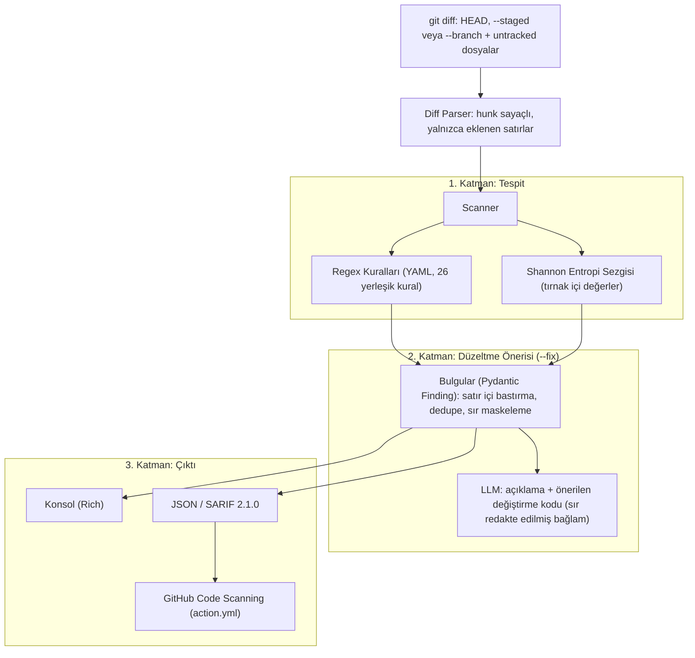

# 🛡️ GitShield

> **AI Destekli PR Güvenlik Denetçisi**  
> *Git diff'indeki yeni eklenen satırlarda sır ve OWASP kalıplarını arar; bulgular için LLM destekli düzeltme önerisi üretir.*

[](https://github.com/AlperEnesErsu/GitShield/actions)
[](https://www.python.org/)
[](LICENSE)
[]()

---

## 🎯 Neden GitShield?

Geleneksel SAST (Statik Kod Analizi) araçları geliştiricilerin önüne yüzlerce satırlık uyarı yığar ve çoğu zaman bu uyarılar kapatılıp geçilir.

**GitShield'ın Farkı:**
1. **Sıfır Gürültü:** Yalnızca değişen satırları (git diff'inin `+` satırları) tarar. Eski kod tabanındaki borçlar süreci tıkamaz.
2. **Regex + Shannon Entropisi:** Bilinen sır biçimleri YAML kurallarıyla, bilinmeyen rastgele görünümlü değerler ise entropi sezgisiyle aranır. Entropi eşiği token uzunluğuna göre ayarlanır; SHA, UUID, dosya yolu, sürüm ve tanımlayıcı gibi yaygın değerler dışarıda tutulur. Bu bir sezgisel yöntemdir: yanlış pozitif de yanlış negatif de üretebilir, bir doğruluk oranı iddia edilmez.
3. **OWASP Odaklı Kalıplar:** SQL Injection (string birleştirme), komut enjeksiyonu (`shell=True`), `eval`/`exec`, `pickle`, MD5/SHA1, `dangerouslySetInnerHTML` gibi kalıpları satır bazlı regex ile arar. AST veya veri akışı analizi yoktur.
4. **💡 LLM Düzeltme Önerisi:** `--fix` bayrağıyla her bulgu için açıklama ve önerilen değiştirme kodu üretilir. Öneri otomatik uygulanmaz ve test edilmez; geliştirici inceleyip uygular. Web panelindeki düzeltme PR'ı ise önizlemeli ve düzenlenebilir olarak açılır.
5. **Üç Kullanım Biçimi:** Yerel terminal (`gitshield scan`), GitHub Action (SARIF'i Code Scanning'e yükler) ve PR inceleme paneli (`gitshield web`).

---

## 🏗️ Sistem Mimarisi



---

## ⚡ Hızlı Başlangıç

### 1. Kurulum (uv veya pip ile)

```bash
# Depoyu klonlayın
git clone https://github.com/AlperEnesErsu/GitShield.git
cd GitShield

# uv ile ortamı ve bağımlılıkları hazırlayın
uv venv
source .venv/bin/activate  # Windows: .venv\Scripts\activate
uv pip install -e ".[dev]"
```

### 2. LLM Anahtarı (yalnızca `--fix` için)

Tarama için API anahtarı gerekmez. `--fix` kullanacaksanız bir sağlayıcının anahtarını ortam değişkeni olarak ya da çalışma dizinindeki (veya üst dizinlerdeki) `.env` dosyasında tanımlayın; CLI bu dosyayı otomatik yükler.

```bash
export ANTHROPIC_API_KEY="sk-ant-..."   # PowerShell: $env:ANTHROPIC_API_KEY="sk-ant-..."
# veya GEMINI_API_KEY / OPENAI_API_KEY
```

Sağlayıcı seçimi `LLM_PROVIDER` ve `LLM_MODEL` ile yapılır (`anthropic`, `gemini`, `openai`). `LLM_PROVIDER` yoksa sırasıyla `ANTHROPIC_API_KEY`, `GEMINI_API_KEY`, `OPENAI_API_KEY` taranır. Varsayılan modeller: `claude-opus-5-5`, `gemini-flash-latest` (Gemini'nin ücretsiz katmanında Pro modellerin kotası olmadığı için), `gpt-5`.

### 3. Kullanım

```bash
# Çalışma alanı: HEAD ile çalışma ağacı arasındaki değişiklikler + untracked (izlenmeyen) dosyalar
gitshield scan

# Yalnızca git add ile hazırlanmış (staged) değişiklikler
gitshield scan --staged

# PR benzeri inceleme: ana dal ile mevcut dal arasındaki fark
gitshield scan --branch main...HEAD

# Bulgular için LLM düzeltme önerisi üret
gitshield scan --fix

# Bulguları tek tek gez: öneriyi diff olarak gör, uygula / atla / baseline'a ekle
gitshield scan --interactive

# Yalnızca değişiklikleri değil, depodaki tüm izlenen satırları tara
gitshield scan --all

# Mevcut bulguları kabul et (baseline); sonraki taramalar yalnızca yeni bulguları raporlar
gitshield scan --all --update-baseline

# SARIF raporunu dosyaya yaz
gitshield scan --format sarif --output results.sarif

# JSON'u stdout'a yaz (durum mesajları stderr'e gider)
gitshield scan --format json > results.json
```

#### Seçenekler

| Seçenek | Açıklama |
|---|---|
| `PATH` (argüman) | Taranacak depo. Varsayılan: `.` |
| `-s, --staged` | Yalnızca staged değişiklikler (`git diff --cached`). |
| `-b, --branch REF` | Bir ref veya aralıkla karşılaştır (ör. `main...HEAD`, bir commit SHA'sı). |
| `--all` | Değişiklikler yerine çalışma ağacındaki tüm izlenen satırları (ve untracked dosyaları) tarar. `--staged` / `--branch` ile birlikte kullanılamaz. |
| `--no-untracked` | Çalışma ağacı taramasında untracked dosyaları atla. Varsayılan: izlenmeyen, `.gitignore` dışı dosyalar da taranır. |
| `--no-ignore-file` | Depo kökündeki `.gitshieldignore` dosyasını yok say. |
| `--baseline DOSYA` | Kabul edilmiş bulguların baseline dosyası. Varsayılan: depo kökündeki `.gitshield-baseline.json`. |
| `--no-baseline` | Baseline'ı yok say; kabul edilmiş bulgular da raporlanır. |
| `--update-baseline` | Bu taramanın bulgularını baseline dosyasına ekler ve rapor üretmeden 0 ile çıkar. |
| `--no-entropy` | Entropi sezgisini kapat; yalnızca regex kuralları çalışır. |
| `--rules-dir DIZIN` | Dizindeki `*.yaml` kural dosyalarını yerleşik kurallara **ekler** (yerleşik kurallar değiştirilmez). |
| `-f, --fix` | Bulgular için LLM düzeltme önerisi üretir. |
| `-i, --interactive` | Bulguları tek tek inceler: LLM önerisini diff olarak gösterir; uygula, atla, baseline'a ekle veya çık. Yalnızca `console` biçimiyle çalışır. |
| `--format console\|sarif\|json` | Çıktı biçimi. Varsayılan: `console`. |
| `-o, --output DOSYA` | Raporu dosyaya yazar (`sarif` / `json`). Verilmezse `sarif` ve `json` stdout'a basılır. |
| `--fail-on-critical / --no-fail` | Varsayılan açık: HIGH veya CRITICAL bulgu varsa çıkış kodu 1. `--no-fail` ile kapatılır. |

#### Çıkış kodları

| Kod | Anlamı |
|---|---|
| `0` | Tarama tamamlandı; HIGH/CRITICAL bulgu yok. |
| `1` | En az bir HIGH veya CRITICAL bulgu var (`--no-fail` ile devre dışı bırakılabilir). |
| `2` | Tarama çalışamadı: geçersiz ref, git deposu olmayan dizin, git bulunamadı, bilinmeyen `--format`. |

Git hatalarında GitShield sessizce boş rapor üretmez; çıkış kodu 2 ile durur.

#### Sır maskeleme

Konsol, JSON ve SARIF çıktıları sır değerlerini maskeler: 16 karakter ve üzeri değerlerin yalnızca ilk 4 karakteri görünür, daha kısa değerler tamamen gizlenir. Ham sır ne dosyaya ne stdout'a yazılır.

#### Satır içi bastırma (inline suppression)

Yanlış pozitif olduğu bilinen bir satır, aynı satırdaki `gitshield: ignore` yorumuyla susturulabilir (yorum sözdizimi önemli değildir: `#`, `//` vb.):

```python
password = "hunter2-test"  # gitshield: ignore                 # satırdaki tüm bulguları susturur
password = "hunter2-test"  # gitshield: ignore[SEC-GEN-006]    # yalnızca belirtilen kural(lar)ı susturur
```

Bastırma yalnızca yorumun bulunduğu satırı etkiler. Entropi bulgusu `ENTROPY-HIGH-001` kimliğiyle de susturulabilir.

#### Dosya bazlı yoksayma (`.gitshieldignore`)

Taranan deponun kökündeki `.gitshieldignore` dosyası, bulguları hiç raporlanmayacak dosyaları listeler (ör. bilerek sahte sır içeren test fikstürleri). Boş satırlar ve `#` ile başlayan yorumlar atlanır; desenler depo köküne göre POSIX yoluyla `fnmatch` kullanılarak eşleşir:

```gitignore
# sonda "/" → dizin öneki
tests/fixtures/
# glob
tests/test_*.py
# her derinlikte (kökte de)
**/*.min.js
# "/" içermeyen desen dosya adıyla eşleşir
secrets.example
```

CLI dosyayı otomatik okur; `--no-ignore-file` ile kapatılır. Bu repo da kendi test dosyaları için bir `.gitshieldignore` kullanır.

#### Baseline (`.gitshield-baseline.json`)

GitShield'ı bulgusu olan bir depoya eklerken mevcut bulguları tek tek düzeltmek ya da bastırmak gerekmez: baseline dosyası bugün var olan bulguları kabul eder, sonraki taramalar yalnızca **yeni** bulguları raporlar ve çıkış kodunu yalnızca onlara göre belirler.

```bash
gitshield scan --all --update-baseline   # tüm depodaki bulguları kabul et
git add .gitshield-baseline.json         # dosyayı inceleyip commit'leyin
```

- Her kayıt kural kimliği, depo-göreli dosya yolu ve boşlukları normalize edilmiş satır içeriğinden üretilen bir SHA-256 parmak izidir. **Satır numarası parmak izine girmez**; satırın üstüne kod eklenmesi kaydı bozmaz. Satırın içeriği değişirse (ör. sır yenisiyle değiştirilirse) bulgu yeni sayılır.
- Aynı dosyada birebir aynı satır birden fazla kez geçerse her kopya ayrı sayılır; kabul edilmiş bir satırın yeni bir kopyası yine raporlanır.
- Dosyada eşleşen metin veya sır **yoktur**; yalnızca parmak izi, kural kimliği, dosya yolu ve önem tutulur.
- `--update-baseline` mevcut kayıtları korur ve yenilerini ekler (diff taramaları deponun yalnızca bir kısmını gördüğü için dosya baştan yazılmaz). Düzeltilmiş bulguların kayıtlarını temizlemek için dosyayı silip yeniden oluşturun.
- CLI dosyayı otomatik okur; `--baseline DOSYA` ile başka bir yol, `--no-baseline` ile tüm bulgular. Bozuk veya bilinmeyen sürümlü bir baseline dosyası çıkış kodu 2 verir. GitHub Action da depoda commit'lenmiş baseline dosyasını kullanır.

#### Etkileşimli düzeltme (`--interactive`)

`gitshield scan --interactive` önce raporu gösterir, sonra her bulgu için LLM'den bulgunun çevresindeki satırların (±8) yerine geçecek bir öneri ister ve bunu renkli bir diff olarak gösterir. Her bulgu için seçim yapılır:

| Tuş | Ne yapar |
|---|---|
| `a` | Öneriyi dosyaya yazar (satır sonları korunur). Yalnızca uygulanabilir bir öneri varsa sunulur. |
| `s` | Bulguyu olduğu gibi bırakır (varsayılan). |
| `b` | Bulguyu baseline dosyasına ekler (oturum sonunda yazılır). |
| `q` | Kalan bulguları incelemeden çıkar. |

- LLM yalnızca sırları `<REDACTED_SECRET>` ile değiştirilmiş satırları görür. Değiştirmediği satırlar dosyaya gerçek içerikleriyle geri yazılır; yer tutucuyu dosyaya yazacak bir öneri reddedilir ve elle düzeltmeniz istenir. Diff önizlemesinde de sırlar maskelenir.
- Öneri hazırlandıktan sonra dosya değiştiyse uygulanmaz. Aynı dosyada önceki bir düzeltme satırları kaydırdıysa sonraki bulgular yeni konumlarında aranır; önceki düzeltmenin yeniden yazdığı satırdaki bulgu atlanır ve yeniden tarama önerilir.
- LLM anahtarı yoksa öneri üretilmez; yine de bulguları atlayabilir veya baseline'a ekleyebilirsiniz.
- Uygulanan düzeltmeler **test edilmez**; değişikliği inceleyip `gitshield scan` ile yeniden tarayın.
- Çıkış kodu: atlanan veya incelenmeyen bir HIGH/CRITICAL bulgu kalırsa 1, aksi halde 0 (`--no-fail` ile her zaman 0).

#### Yerleşik kurallar

Toplam **26 yerleşik regex kuralı** (20 sır, 6 OWASP) ve bir entropi sezgisi (`ENTROPY-HIGH-001`, HIGH) vardır. Kurallar `gitshield/rules/` altındaki YAML dosyalarında tanımlıdır.

**Sır kuralları (`secrets.yaml`, 20 kural):**

| ID | Başlık | Önem |
|---|---|---|
| `SEC-AWS-001` | AWS Access Key ID | CRITICAL |
| `SEC-GH-002` | GitHub Personal Access Token | CRITICAL |
| `SEC-GH-007` | GitHub OAuth / App / Refresh Token | CRITICAL |
| `SEC-OAI-003` | OpenAI / LLM API Key | CRITICAL |
| `SEC-ANT-012` | Anthropic API Key | CRITICAL |
| `SEC-SLACK-008` | Slack Token | CRITICAL |
| `SEC-SLACK-009` | Slack Incoming Webhook URL | HIGH |
| `SEC-STRIPE-010` | Stripe Live Secret / Restricted Key | CRITICAL |
| `SEC-GCP-011` | Google API Key | HIGH |
| `SEC-NPM-013` | npm Access Token | CRITICAL |
| `SEC-PYPI-014` | PyPI API Token | CRITICAL |
| `SEC-AZURE-015` | Azure Storage Account Key | CRITICAL |
| `SEC-TWILIO-016` | Twilio API Key SID | HIGH |
| `SEC-SENDGRID-017` | SendGrid API Key | CRITICAL |
| `SEC-DISCORD-018` | Discord Webhook URL | HIGH |
| `SEC-TG-019` | Telegram Bot Token | HIGH |
| `SEC-DB-020` | Bağlantı dizesinde gömülü parola | HIGH |
| `SEC-PRIVKEY-004` | Özel kriptografik anahtar bloğu | CRITICAL |
| `SEC-JWT-005` | Sabit kodlanmış JWT | HIGH |
| `SEC-GEN-006` | Sabit kodlanmış secret / parola ataması | HIGH |

**OWASP kuralları (`owasp.yaml`, 6 kural):**

| ID | Başlık | Önem | Dosya kapsamı |
|---|---|---|---|
| `OWASP-A03-SQLI-001` | SQL Injection (string biçimlendirme ile sorgu) | CRITICAL | py, js, jsx, ts, tsx |
| `OWASP-A03-CMDI-002` | Komut enjeksiyonu (`shell=True`, `os.system`) | HIGH | py |
| `OWASP-A03-EVAL-003` | `eval()` / `exec()` kullanımı | CRITICAL | py, js, jsx, ts, tsx |
| `OWASP-A08-PICKLE-004` | Güvensiz deserialization (`pickle`) | HIGH | py |
| `OWASP-A02-HASH-005` | Zayıf hash (MD5 / SHA1) | MEDIUM | py |
| `OWASP-A03-XSS-006` | `dangerouslySetInnerHTML` | HIGH | js, jsx, ts, tsx |

**Entropi sezgisi (`ENTROPY-HIGH-001`, HIGH):** Yalnızca tırnak içindeki değerler değerlendirilir ve şu filtrelerden geçmesi gerekir:
- 16–128 karakter uzunluğunda ve sır karakter kümesinden (base64 / base64url / ayırıcılar) oluşmalı; en az iki karakter sınıfı (küçük harf, büyük harf, rakam) içermeli.
- Saf hex değerler (SHA, SHA-256 vb.) yalnızca `key`, `token`, `secret`, `password` gibi bir ad atamasının hemen önünde ise incelenir.
- Eşik token uzunluğuna göre belirlenir: `min(taban, 0.8 · log2(uzunluk))`; hex için taban 3.2, diğerleri için 4.3.
- Şu biçimler her zaman dışarıda tutulur: `http(s)://` ve MIME türü değerleri, UUID, dosya yolları, noktalı tanımlayıcılar (`com.example.service`), sürüm numaraları, tekrarlayan veya ardışık karakterli değerler.
- Lockfile'lar (`package-lock.json`, `uv.lock`, `go.sum` vb.) entropi sezgisinin dışındadır; bütünlük hash'leri rastgele görünür.

#### Özel kurallar (`--rules-dir`)

Kural dosyası `rules:` listesi içeren bir YAML'dir ve dizinde `*.yaml` uzantısıyla bulunmalıdır:

```yaml
rules:
  - id: 'ORG-SEC-001'
    title: 'Kurum İçi Servis Token'
    description: 'Kurum içi servis token değeri kaynak koda gömülmüş.'
    severity: 'HIGH'                  # CRITICAL | HIGH | MEDIUM | LOW | INFO
    rule_type: 'SECRET'               # SECRET | OWASP | ENTROPY | DEPENDENCY
    pattern: 'svc_[A-Za-z0-9]{32}'    # Python regex; her satır ayrı taranır
    cwe: 'CWE-798'                    # isteğe bağlı
    remediation: 'Değeri ortam değişkeninden okuyun.'   # isteğe bağlı
    file_patterns: ['*.py', '*.ts']   # isteğe bağlı: yalnızca bu dosyalar (glob, tam yol veya dosya adı)
    exclude_patterns: ['tests/*']     # isteğe bağlı: bu dosyalar hariç
    skip_placeholders: false          # true ise "value" adlı named group yer tutucu değerse atlanır
```

Notlar: `pattern` satır bazlıdır. `skip_placeholders` için desende `(?P<value>...)` grubu olmalıdır. Yer tutucu sayılan değerler (`changeme`, `example`, `${...}`, `<...>`, `os.getenv(...)` vb.) bu grupta atlanır. Hatalı kural dosyaları uyarı basılarak atlanır.

#### Dosya kapsamı

Yerleşik OWASP kuralları `file_patterns` ile belirli uzantılara sınırlıdır. Bu alanlar özel kurallarda da kullanılabilir. Eşleşme, dosyanın tam yolu veya dosya adı üzerinden `fnmatch` ile yapılır.

---

## 🤖 GitHub Action

Depoda `action.yml` composite bir GitHub Action olarak bulunur. Pull request'in diff'ini (`base...HEAD`) tarar, SARIF raporu üretir ve GitHub Code Scanning'e yükler.

```yaml
name: GitShield

on:
  pull_request:

permissions:
  contents: read
  security-events: write

jobs:
  gitshield:
    runs-on: ubuntu-latest
    steps:
      - uses: actions/checkout@v7
        with:
          fetch-depth: 0   # base commit'in geçmişte bulunması için gerekli

      - uses: AlperEnesErsu/GitShield@main
        with:
          fail-on-high: "true"
```

| Input | Varsayılan | Açıklama |
|---|---|---|
| `base-ref` | `github.event.pull_request.base.sha` | Karşılaştırılacak temel commit veya ref. |
| `format` | `sarif` | `sarif`, `json` veya `console`. |
| `output` | `gitshield.sarif` | Rapor dosyasının yolu (çalışma alanına göre). |
| `fail-on-high` | `true` | HIGH/CRITICAL bulguda job'u başarısız yapar. Tarama hataları her zaman job'u başarısız yapar. |
| `upload-sarif` | `true` | SARIF'i Code Scanning'e yükler (`format: sarif` gerektirir). |
| `python-version` | `3.12` | GitShield'ı kurmak için kullanılan Python sürümü. |

Notlar:
- Action GitShield'ı kendi dizininden (`pip install`) kurar ve tarama için `--branch "base...HEAD"` kullanır; yani yalnızca commit edilmiş PR farkı taranır, çalışma ağacı taranmaz.
- Action `--fix` çalıştırmaz.
- Fork'tan gelen PR'larda token salt okunur olabilir; SARIF yükleme başarısız olabilir, ancak tarama adımı yine çalışır ve sonucu belirler.

---

## 🖥️ Web Dashboard (PR Review Merkezi)

Erişim yetkin olan tüm GitHub repolarını tablolaştırır, açık PR'ları AI ile inceler, üretilen
review'u ikinci bir LLM geçişiyle doğrular ve **senin onayınla** PR'a gönderir.

- **Repolar tablosu:** açık PR / issue sayıları, açılmamış taslak issue'lar, son push, yetki; sıralama ve filtre.
- **Repo sayfası:** PR tablosu + katlanır iki bölüm: GitHub issue'ları ve bulgulardan üretilen
  *henüz açılmamış taslak issue'lar* (düzenle → "GitHub'da aç" ya da yoksay).
- **PR sayfası:** GitShield taraması → AI review → doğrulayıcı (doğrulandı / belirsiz / reddedildi).
  Yorumları seç, düzenle, diff üzerinde satır içinde gör, onaylayıp GitHub'a gönder.

**İş akışını hızlandıran özellikler (GitHub'da yok):**

| Özellik | Ne yapar |
|---|---|
| **Bekleyenler** (`/inbox`) | Tüm repolardaki onay bekleyen review'lar, yeni commit'ler, incelenmemiş PR'lar ve taslak issue'lar tek listede, aciliyet ve risk sırasıyla. |
| **Otomatik inceleme** | Repo sayfasındaki anahtarla açılır; yeni PR ya da commit gelince arka planda incelenir, sonuç onayını bekler. |
| **Hızlı mod** (`/triage`) | Klavyeyle onay: `j/k` yorumlar, `x` çıkar, `m` bir daha söyleme, `a/r/c` karar, `Enter` gönder, `n` atla. |
| **Risk skoru** | Her PR için 0-100 açıklamalı skor: boyut, hassas dosyalar, CI, yeni katkıcı, testsiz kod, major sürüm. |
| **Bağımlılık toplu onayı** | CI'ı yeşil minor/patch Dependabot PR'ları taranıp tek tıkla onaylanır; kurallar sunucuda da uygulanır. |
| **Artımlı inceleme** | Yeni commit'lerde yalnızca fark incelenir; önceki yorumların düzeltilip düzeltilmediği takip edilir. |
| **Repo hafızası** | Susturulan yorumlar tekrarlanmaz; repoya özel kurallar her review'a verilir. |
| **Düzeltme PR'ı** | Bir yorumdan önizlemeli, düzenlenebilir küçük bir düzeltme PR'ı açılır. |
| **Bildirimler** | Masaüstü bildirimi ve Slack / Discord / Telegram. |
| **Metrikler** (`/metrics`) | Merge süresi, açık PR yaşı, SLA'yı aşanlar ve GitShield'ın kendi gecikmeleri. |
| **CI teşhisi** | Kırık CI'ın günlüğünü okur, bilinen nedenleri (Docker limiti, Dependabot secret'ı, Node sürümü, peer çakışması, audit…) tanır, hedef dalla karşılaştırır ve suçun PR'da mı ortamda mı olduğunu söyler; risk skoru da buna göre ayarlanır. |
| **Seri ve rozetler** (`/achievements`) | Günlük hedef, seri, XP/seviye, 16 rozet, yeni rozet kutlaması ve 26 haftalık review takvimi. |
| **Bugün paneli** | Ana sayfada bekleyen işler, seri durumu ve tek bir "sıradaki adım". |
| **Komut paleti** (`Ctrl+K`) | Repo, bekleyen PR, sayfa ve eylemlere yazarak anında atla. |

```bash
uv pip install -e ".[web]"
cd web && npm install && npm run build && cd ..
gitshield web            # http://127.0.0.1:8000
```

Geliştirme için `gitshield web --reload` ve ayrı bir terminalde `cd web && npm run dev`
(http://localhost:5173, `/api` istekleri 8000'e proxy'lenir).

### Web ortam değişkenleri

Web sunucusu `.env` dosyasını okur. Tüm değişkenler isteğe bağlıdır; varsayılanlar aşağıdadır.

| Değişken | Varsayılan | Açıklama |
|---|---|---|
| `LLM_PROVIDER` | otomatik | `anthropic`, `gemini`, `openai` veya `none` (yalnızca statik tarama). Belirtilmezse sırasıyla `ANTHROPIC_API_KEY`, `GEMINI_API_KEY`, `OPENAI_API_KEY`'e bakılır. |
| `LLM_MODEL` | sağlayıcıya göre | Model adı. Varsayılanlar: `claude-opus-5-5`, `gemini-flash-latest`, `gpt-5`. |
| `LLM_FALLBACK_MODEL` | `gemini-3.5-flash` (Gemini) | Gemini'de birincil model zaman aşımına uğrar veya 5xx dönerse kullanılan yedek model. |
| `LLM_EFFORT` | `medium` | Anthropic akıl yürütme derinliği: `low`, `medium`, `high`, `xhigh`, `max`. Yükseldikçe yavaşlar ve maliyet artar. |
| `GITSHIELD_MAX_LLM_CALLS_PER_DAY` | `200` | Son 24 saatte yapılabilecek LLM isteği üst sınırı (inceleme, doğrulama, düzeltme, CI teşhisi). `0` = sınırsız. |
| `GITSHIELD_MAX_AUTO_REVIEWS_PER_DAY` | `20` | Otomatik incelemenin son 24 saatte başlatabileceği review sayısı. Elle başlatılan review'lar sayılmaz. `0` = sınırsız. |
| `GITSHIELD_MAX_DIFF_CHARS` | `150000` | LLM'e gönderilen diff karakter sınırı. Aşan dosyalar atlanmış olarak listelenir. |
| `GITSHIELD_AUTO_REVIEW_INTERVAL` | `300` | Otomatik inceleme için saniye cinsinden yoklama aralığı. `0` = kapalı. |
| `GITSHIELD_GAMIFICATION` | `on` | `off` yapılırsa rozetler, XP ve seriler gizlenir. |
| `GITSHIELD_API_TOKEN` | boş | Ayarlanırsa her `/api` isteği `Authorization: Bearer <token>` başlığı veya `gitshield_token` çerezi ister. Tarayıcı için `http://127.0.0.1:8000/?token=<token>` adresini bir kez açmak yeterlidir (çerez HttpOnly ve SameSite=Strict'tir). |
| `GITSHIELD_REVIEW_LANGUAGE` | `Turkish` | Reviewer'ın yorumlarını yazacağı dil. |
| `GITSHIELD_DB` | `.gitshield/web.db` | SQLite veritabanı yolu. |
| `GITSHIELD_ALLOWED_HOSTS` | boş | Sunucunun yanıt vereceği ek yerel host adları (virgülle ayrılmış). |
| `GITSHIELD_PUBLIC_URL` | `http://127.0.0.1:8000` | Bildirim linklerinde kullanılan temel adres. |
| `GITHUB_TOKEN` | boş | Boşsa `gh auth token` çıktısı kullanılır. |

Bildirim kanalları (`GITSHIELD_SLACK_WEBHOOK`, `GITSHIELD_DISCORD_WEBHOOK`, `GITSHIELD_TELEGRAM_BOT_TOKEN` + `GITSHIELD_TELEGRAM_CHAT_ID`) isteğe bağlıdır. Gemini'nin ücretsiz katmanında Pro modellerin kotası olmadığından varsayılan Gemini modeli `gemini-flash-latest`'tir.

**Güvenlik modeli.** Sunucu senin GitHub token'ınla çalışır, bu yüzden:

- varsayılan olarak yalnızca `127.0.0.1`'e bağlanır (`--host` ile değiştirilebilir); ağa açmadan önce `GITSHIELD_API_TOKEN` ayarlayın;
- yalnızca yerel `Host` adlarına (`127.0.0.1`, `localhost`, `::1`; ek olarak `GITSHIELD_ALLOWED_HOSTS`) yanıt verir — DNS rebinding ile özel repo verisinin okunmasını engeller;
- her yazma isteğinde `X-GitShield-Client` başlığını ve yerel bir `Origin`'i şart koşar — tarayıcıda açık
  başka bir sitenin senin adına issue açması, CI çalıştırması ya da review göndermesi (CSRF) engellenir;
- GitHub'a yazan her işlem (review, toplu onay, düzeltme PR'ı, issue, CI yeniden çalıştırma) arayüzde
  ayrıca onay ister; PR içeriği LLM'e "güvenilmeyen veri" olarak verilir ve taramada bulunan sırlar LLM'e gönderilmeden maskelenir.

**Kısayollar:** `Ctrl+K` komut paleti · hızlı modda `j/k`, `x`, `m`, `a/r/c`, `Enter`, `n/p`, `?`.

---

## 📁 Proje Yapısı

```
GitShield/
├── gitshield/
│   ├── cli.py                # Typer CLI: scan, web, version
│   ├── core/
│   │   ├── diff_parser.py    # git diff çağrısı, untracked dosyalar, hunk ayrıştırma
│   │   ├── scanner.py        # Tarama hattı, satır içi bastırma, lockfile kuralı
│   │   ├── baseline.py       # Baseline dosyası: parmak izi, okuma, birleştirerek yazma
│   │   ├── entropy.py        # Shannon entropisi ve token filtreleri
│   │   └── models.py         # Finding, DiffHunk, ScanReport (Pydantic) ve maskeleme
│   ├── rules/
│   │   ├── engine.py         # YAML kural yükleyici, dosya kapsamı, yer tutucu filtresi
│   │   ├── secrets.yaml      # 20 sır kuralı
│   │   └── owasp.yaml        # 6 OWASP kuralı
│   ├── ai/
│   │   ├── remediator.py     # CLI --fix / --interactive: LLM çağrısı, sır redaksiyonu, satır aralığı önerisi
│   │   └── prompts.py        # Düzeltme prompt şablonları
│   ├── interactive.py        # --interactive: diff önizleme, uygula / atla / baseline döngüsü
│   ├── formatters/
│   │   ├── console.py        # Rich terminal çıktısı
│   │   └── sarif.py          # SARIF 2.1.0 üretici
│   └── web/                  # FastAPI: GitHub API, review hattı, LLM sağlayıcıları, bütçe, SQLite
├── web/                      # React + Vite dashboard
├── tests/                    # Birim ve entegrasyon testleri
├── action.yml                # Composite GitHub Action
├── .gitshieldignore          # Kendi taramasında yoksayılan test dosyaları
├── .github/workflows/        # CI (test, ruff, mypy, self-scan, web build) ve Dependabot
├── .env.example              # Ortam değişkenleri şablonu
├── ARCHITECTURE.md           # Mimari ve tasarım kararları
├── LICENSE                   # MIT
└── pyproject.toml            # Paket tanımı (uv uyumlu)
```

---

## 🛠️ Geliştirme

```bash
uv sync --all-extras              # tüm bağımlılıklar (web ve dev dahil)
uv run pytest                     # testler
uv run ruff check gitshield tests # lint
uv run mypy gitshield             # tip denetimi
cd web && npm ci && npm run build # web panelinin derlenmesi
```

CI (`.github/workflows/ci.yml`) testleri Ubuntu'da Python 3.11–3.13, Windows'ta Python 3.12 ile çalıştırır; ruff ve mypy ayrı bir işte çalışır. Pull request'lerde GitShield kendi diff'ini de tarar.

---

## 🗺️ Yol Haritası (Roadmap)

- [x] **Faz 1:** Proje iskeleti, git diff ayrıştırıcı (tırnak/escape'li yollar, untracked dosyalar), Shannon entropi motoru.
- [x] **Faz 2:** YAML kural motoru: 26 yerleşik kural, dosya kapsamı, satır içi bastırma, özel kural dizini, yer tutucu değer filtresi.
- [x] **Faz 3:** LLM düzeltme önerisi (CLI `--fix`; Anthropic, Gemini, OpenAI) ve web panelinde önizlemeli düzeltme PR'ı.
- [x] **Faz 4:** Rich terminal görselleştirmesi ve `--interactive` düzeltme modu.
- [x] **Faz 5:** GitHub Action (`action.yml`): PR diff'ini tarar, SARIF'i Code Scanning'e yükler. Satır içi PR yorumları web panelinde.
- [x] **Faz 6:** SARIF 2.1.0 çıktısı (`partialFingerprints` ve `security-severity` ile) ve GitHub Code Scanning entegrasyonu.

**Sonraki adımlar:**
- [ ] Satır bazlı regex yerine AST tabanlı analiz (ör. Python `ast` ile girdi-çıktı akışı) ve daha az yanlış pozitif.
- [ ] Sır canlılık doğrulaması: sızan bir anahtarın hâlâ geçerli olup olmadığını sağlayıcı API'si üzerinden kontrol etmek.
- [x] Baseline dosyası: mevcut bulguları kabul edip yalnızca yeni bulguları raporlamak (`--update-baseline`, `--all`).
- [ ] OWASP kurallarının Go, Java, PHP ve Ruby gibi diğer dillere genişletilmesi.
- [ ] Tedarik zinciri kuralları: `RuleType.DEPENDENCY` tanımlı, ancak henüz hiçbir yerleşik kural kullanmıyor.

---

## 🤝 Katkıda Bulunma

1. Depoyu fork edin (`fork`).
2. Özellik dalınızı oluşturun (`git checkout -b feat/harika-ozellik`).
3. Değişikliklerinizi commit edin (`git commit -m 'feat: harika ozellik eklendi'`).
4. Dalınıza push yapın (`git push origin feat/harika-ozellik`).
5. Bir Pull Request açın.

Göndermeden önce `uv run pytest`, `uv run ruff check gitshield tests` ve `uv run mypy gitshield` komutlarını çalıştırın.

---

## 📄 Lisans

Bu proje [MIT Lisansı](LICENSE) altında lisanslanmıştır. Telif hakkı: © 2026 Alper Enes Ersü.
